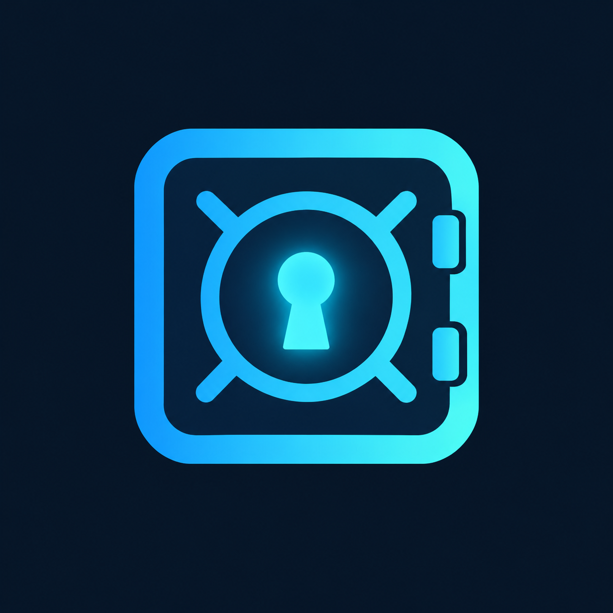

<p align="center">
  
</p>

<h1 align="center">mySecrets</h1>

<p align="center">
  Your passwords, your device, your secrets.
  <br/>
  A <b>local-first</b> password manager for Android — encrypted vault on your phone,
  <b>zero network</b>, offline by design.
</p>

<p align="center">
  
</p>

Your passwords live in an **encrypted vault on your device**: AES-GCM encryption,
Argon2id key derivation from your master passphrase, and hardware-backed key
storage. Nothing ever leaves your phone.

## Why

Two problems kill password hygiene for most people: reusing the same password
everywhere, and forgetting which password goes where. mySecrets solves both
locally — a trusted vault, strong generation on tap, and rotation reminders —
without trusting any cloud.

## Features

| Feature | Status | How it works |
|---------|--------|--------------|
| Encrypted local vault | ✅ done | AES-GCM payload, KEK-wrapped DEK in secure storage |
| Master passphrase setup | ✅ done | Strength meter + explicit *no recovery* acknowledgment |
| Lock / unlock lifecycle | ✅ done | Locks on demand; wrong passphrase never decrypts |
| Encrypted manual backup | ✅ done | Self-contained `.mysenc` file, restorable on any device |
| Zero network | ✅ guard-tested | Release manifest requests no `INTERNET` permission |
| Biometric / PIN gate | 🚧 next | Mercado Pago style unlock (secure-access spec) |
| Password & passphrase generator | ✅ done | CSPRNG + entropy meter + one-tap Generate |
| Rotation reminders | 🚧 next | Per-credential 90/180/365-day policy (renewal-reminders spec) |

## Security model

```
Master passphrase ──Argon2id──> KEK ──wraps──> DEK ──AES-GCM──> vault data
                                   (salt + params live in the versioned vault header)
```

The design keeps **what you know** (the passphrase) strictly separated from
**where it lives** (the Data Encryption Key stored via hardware-backed
Keychain/Keystore). Databases only ever store ciphertext blobs — there are no
plaintext columns, and a regression test asserts it stays that way.

- Forgetting the master passphrase means **the data is gone** — on purpose.
  No backdoors, no reset, no recovery keys.
- The export flow requires re-entering the master passphrase, so the resulting
  `.mysenc` is self-contained and safe wherever you keep it.

## Quick path

```bash
# 1. Clone and fetch dependencies
git clone https://github.com/HeikyuDev/mysecrets.git
cd mysecrets
flutter pub get

# 2. Run the test suite (45+ tests) and static analysis
flutter test
flutter analyze

# 3. Launch on a device or emulator
flutter run
```

> **Note:** to build with plugins on Windows, enable Developer Mode
> (`start ms-settings:developers`) so symlinks are allowed.

## Project layout

| Path | Role |
|------|------|
| `lib/vault/crypto/` | Argon2id KDF, AES-GCM cipher, versioned vault header, CSPRNG |
| `lib/vault/keys/` | Key manager, wrapped-DEK secure storage |
| `lib/vault/vault_service.dart` | Lock/unlock lifecycle + ciphertext-only CRUD |
| `lib/vault/export/` | `.mysenc` export / restore |
| `lib/generator/` | CSPRNG password + passphrase generation, entropy meter |
| `lib/data/` | Drift (SQLite) schema — blobs only, no plaintext columns |
| `lib/app/` + `lib/ui/` | `VaultController` state + setup / unlock / home screens |
| `test/` | Unit, integration, widget, and zero-network guard tests |

## Stack

Flutter 3.47 (Dart) · drift (SQLite) · pointycastle (Argon2id + AES-GCM) ·
flutter_secure_storage (hardware-backed keys)

## Roadmap

1. `secure-access` — biometric + PIN gate, auto-lock
2. `renewal-reminders` — local notifications when a credential turns "due"

Each capability is planned as a spec (proposal → spec → design → tasks) before
implementation. vault-core, the encrypted storage engine, is already built.
